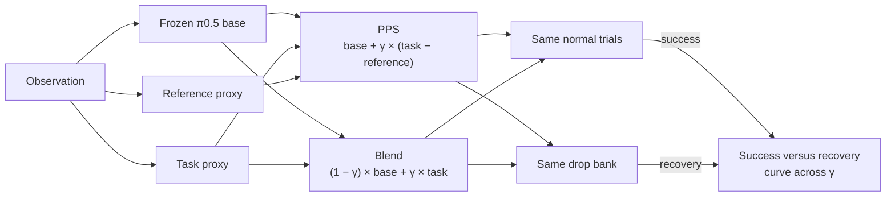

# PPS Self-Training



## How it works

This project studies the trade-off between **task success** and **recovery** from disturbances when a frozen robot
generalist, **π0.5**, is adapted to a new task. **Proxy Policy Steering** (PPS, arXiv 2609.09148) is studied in depth.
PPS keeps the base frozen and trains two small proxies. The **reference proxy** is distilled from the base. The
**task proxy** starts as a copy of the reference and is fine-tuned on task demos.

Both methods change only the velocity at each of the 10 flow matching denoising steps. PPS adds γ times the
difference of the two proxies to the base velocity. The **blend** mixes the base and the task proxy directly.

```
v_pps   = v_base + γ * (v_task - v_ref)
v_blend = (1 - γ) * v_base + γ * v_task
```

Replace the reference proxy with the base itself (v_ref = v_base) and PPS becomes exactly the blend. The reference
proxy is the only thing PPS adds. The main question is whether it gives a better success versus recovery trade-off
than the blend across γ. Follow-up questions are

- which recoveries each method loses, and why
- what self-training on a method's own successes does to the trade-off
- where LoRA, DSRL, online UF-OPS and a residual policy land on the same curve

This builds on the official PPS code (github.com/TritiumR/pps) and runs in **LIBERO**, a setting their repo does not
cover. All runs use openpi's pi05_libero checkpoint on LIBERO-90 task 59 (**t59**), "pick up the tomato sauce and put
it in the tray", which is outside pi05_libero's fine-tuning data.

## Repository layout

```
pps_real/                     shared code for π0.5 in LIBERO
  sampler.py                  openpi's sampler with a per step velocity hook
  policy.py                   SteerablePolicy, openpi's input and output transforms around the sampler
  libero_obs.py               LIBERO observation to policy input, as openpi's LIBERO client does it
  perturb.py                  grasp test and forced gripper open
scripts/
  m0/                         base checkpoint and task screen on LIBERO-90
  stage2/                     t59 data, proxy training and proxy checks
    export_demo_states.py     demo sim states from the LIBERO hdf5
    render_demo_obs.py        policy observations for every demo frame
    collect_distill.py        (x_t, t, v_base) on π0.5's own path, the reference distillation set
    paper_proxy.py            v3 ours proxy, DINOv3 ViT-S/16 encoder and a Gemma style action expert
    train_reference_paper.py  reference proxy distillation
    build_task_data.py        demo action chunks in π0.5's action space
    train_task_paper.py       task proxy fine-tuning, initialized from the reference
    check_task_paper.py       proxy fidelity on the distillation set
  stage3/                     t59 evaluation
    serve_eval.py             policy server for the base, pps and task methods
    pps_steer.py              PPS hook and the task proxy alone
    t59_sim.py                env setup, mid-carry event, exact snapshots and the drop
    run_t59.py                normal trials, drop branches and replay checks
    select_pool.py            picks the saved drop states
    check_gamma0.py           γ = 0 against π0.5, bit for bit
    run_4090.sh               full unattended eval on the RTX 4090
    summarize_4090.py         results.json and SUMMARY.md for a run
  toy/                        one script per step of the PushT toy
toy/                          PushT toy of the whole pipeline, small enough for a laptop
docs/                         notes on the toy and on stage 2
results/                      small tracked result files
runs/eval_t59/                tracked summary of the first t59 eval
data/  checkpoints/           local only, ignored by git
```

## Setup

### 1. Environment

All evaluation runs on an **RTX 4090** (24 GB). Policy numerics in bf16 differ between GPU types from the first
policy call, so trials from different GPUs cannot be paired. Heavy training runs on an RTX PRO 6000.

Everything lives on the pod's network volume at /workspace. Two Python environments come from openpi at commit
215abfb.

- **openpi venv**, /workspace/openpi/.venv, Python 3.11 with torch 2.7.1+cu128. It runs π0.5, the proxies, the
  policy servers and training. Its python links to the container's /usr/bin/python3.11, so the image must ship
  Python 3.11.
- **LIBERO venv**, /workspace/openpi/examples/libero/.venv, Python 3.8. It runs the simulator clients.

Our changes to openpi (torch from the PyTorch cu128 index) are in results/m0/openpi_local.patch. To rebuild the
venvs, follow openpi's README and examples/libero/README.md at that commit and apply the patch. The proxies need timm
1.0.20 or newer for DINOv3. It sits in /workspace/.cache/proxy_pylib, installed with `--no-deps` so the openpi venv
stays untouched. The PushT toy uses this repo's own uv environment (Python 3.12, `uv sync`).

A fresh container lacks the glvnd EGL loader, and MuJoCo rendering fails. Install the EGL packages on every new
container, since they live outside /workspace. Then source the environment file, which keeps all caches on the
network volume and sets `MUJOCO_GL=egl` and `LIBERO_CONFIG_PATH=/workspace/.libero`.

```bash
apt-get install -y libegl1 libgl1 libglvnd0
source /workspace/env.sh
```

Each policy server holds π0.5 and both proxies in about 8 GB. Run at most **2 policy servers** on one 24 GB card. A
third runs out of memory on its first call. RunPod's nginx holds port 8001, so servers use 8010 and 8011.

### 2. Assets and checkpoints

None of this is in git. data/ and checkpoints/ in the repo are empty placeholders.

```
/workspace/
├── env.sh                     environment variables, source first
├── .libero/config.yaml        LIBERO paths
├── openpi/                    openpi at 215abfb, with both venvs and third_party/libero
├── external/pps_official/     official PPS code, cloned from github.com/TritiumR/pps at a22f9ad
├── pps-selftrain/             this repo
├── checkpoints/
│   ├── openpi/                openpi's download cache (OPENPI_DATA_HOME)
│   └── pi05_libero_pytorch/   π0.5 base in PyTorch
├── data/
│   ├── libero_datasets/       LIBERO demo hdf5 files
│   ├── t59_demos/             t59 demo sim states and rendered policy observations
│   ├── t59_distill/           reference proxy distillation set
│   └── t59_task/              task proxy targets
└── runs/                      proxy checkpoints, eval runs and logs
```

The t59 demos come from the Hugging Face dataset yifengzhu-hf/LIBERO-datasets. serve_eval.py loads these
checkpoints by default.

| Checkpoint | Path |
|---|---|
| π0.5 base (pi05_libero, PyTorch bf16) | /workspace/checkpoints/pi05_libero_pytorch |
| Reference proxy, v3 ours | /workspace/runs/reference_t59_paper_all50/final.pt |
| Task proxy, v3 ours | /workspace/runs/task_t59_paper_all50/final.pt |

### 3. Base policy

The base is openpi's **pi05_libero** checkpoint, converted from JAX to PyTorch bf16 with openpi's converter. The
converter does not copy the norm stats for this layout, so copy the assets folder by hand.

```bash
cd /workspace/openpi
.venv/bin/python examples/convert_jax_model_to_pytorch.py \
    --checkpoint_dir /workspace/checkpoints/openpi/openpi-assets/checkpoints/pi05_libero \
    --config_name pi05_libero \
    --output_path /workspace/checkpoints/pi05_libero_pytorch
cp -r /workspace/checkpoints/openpi/openpi-assets/checkpoints/pi05_libero/assets /workspace/checkpoints/pi05_libero_pytorch/
```

The base always runs **eager**. The steering hook needs the eager path, and torch.compile changes individual
trajectories.

## Training

These commands train the **v3 ours** proxies. Run them in the openpi venv from the repo root, except
render_demo_obs.py, which needs the LIBERO venv. Each script's docstring lists its options. The repo has no training
scripts for the faithful proxies yet.

```bash
cd /workspace/pps-selftrain
source /workspace/env.sh
export PYTHONPATH=.
PY=/workspace/openpi/.venv/bin/python
```

**Distillation data.** The frozen base is rolled from 16 seeded noise draws on every frame of the 50 t59 demos, and
(x_t, t, v_base) is recorded at each denoising step on its own path.

```bash
$PY scripts/stage2/export_demo_states.py
PYTHONPATH=.:/workspace/openpi/third_party/libero /workspace/openpi/examples/libero/.venv/bin/python \
    scripts/stage2/render_demo_obs.py
$PY scripts/stage2/collect_distill.py
$PY scripts/stage2/verify_distill.py
```

**Reference proxy**, distilled from the stored base velocities. 20,000 steps at batch 64 on all 50 demos.

```bash
$PY scripts/stage2/train_reference_paper.py --all-demos --out /workspace/runs/reference_t59_paper_all50
```

**Task proxy**, initialized from the reference and fine-tuned on the demo action chunks with openpi's flow matching
loss.

```bash
$PY scripts/stage2/build_task_data.py
$PY scripts/stage2/train_task_paper.py \
    --init /workspace/runs/reference_t59_paper_all50/final.pt --out /workspace/runs/task_t59_paper_all50
$PY scripts/stage2/check_task_paper.py
```

final.pt in each output directory is the model.

## Evaluation

Evaluation pairs policy servers in the openpi venv with simulator clients in the LIBERO venv. Run everything from the
repo root on the RTX 4090. Each server loads π0.5 and both proxies and serves every method. The client picks one per
request with `--method`, which is `base`, `pps` or `task`. Clients write `<out>/<method>/<name>.jsonl` and resume
where they stopped.

```bash
cd /workspace/pps-selftrain
source /workspace/env.sh
SPY=/workspace/openpi/.venv/bin/python
CPY=/workspace/openpi/examples/libero/.venv/bin/python
R=/workspace/runs/eval_t59_4090
PYTHONPATH=. $SPY scripts/stage3/check_gamma0.py --out $R/checks/gamma0_check.json
PYTHONPATH=. $SPY scripts/stage3/serve_eval.py --port 8010 &
PYTHONPATH=. $SPY scripts/stage3/serve_eval.py --port 8011 &
export PYTHONPATH=.:/workspace/openpi/third_party/libero
```

run_4090.sh runs the normal trials and the drop test below unattended on two servers, for the base, PPS at γ 0.4 and
the task proxy alone, then writes results.json and SUMMARY.md. It reuses the saved states already in $R/pool. Create
$R/STOP to end it early.

```bash
nohup setsid bash scripts/stage3/run_4090.sh > /workspace/runs/eval_t59_4090/logs/run_4090.nohup 2>&1 < /dev/null &
```

> [!IMPORTANT]
> **Eval rules**
> - Run every eval on one GPU type, the RTX 4090.
> - γ = 0 must reproduce π0.5 bit for bit. check_gamma0.py tests this before any PPS run.
> - Every saved drop state leaves at least 130 env steps of the trial's budget after the event.
> - Restoring a state never calls mj_forward. It rewrites qacc_warmstart and changes the next step.
> - The drop holds the arm still and forces the gripper open for 10 steps.
> - Success and recovery definitions are written down before a run.

### Normal trials

Trial i starts from LIBERO init state i mod 50 with env seed 7 + i and its own noise stream, so every method sees the
same trials. Each trial runs 10 settle steps and up to 400 policy steps, replanning every 5 actions. Success is
LIBERO's own goal check. π0.5 trials also save a snapshot at their first mid-carry event for the drop bank.

```bash
$CPY scripts/stage3/run_t59.py paired --port 8010 --method base --trial-list $(seq 0 199) --out $R
$CPY scripts/stage3/run_t59.py paired --port 8011 --method pps --trial-list $(seq 0 199) --out $R
```

### Drop test

The **drop bank** is 40 saved states, each a π0.5 trial snapshotted at its first **mid-carry event**. At that step the
bottle is grasped, at least 5 cm above its resting height and at least 5 cm from the tray. A **drop branch** restores a state, holds
the arm still with the gripper forced open for 10 steps, then lets the policy replan until success or the end of the
trial's budget. Each state has 5 branches with their own noise, so each method gets 200 branches. A branch that
succeeds is a **recovery**.

Select the states, check that branching is exact, then run the branches.

```bash
python3 scripts/stage3/select_pool.py --root $R
$CPY scripts/stage3/run_t59.py simreplay --port 8010 --out $R --states $(seq 0 39)
$CPY scripts/stage3/run_t59.py replay --port 8010 --out $R --states $(seq 0 39)
$CPY scripts/stage3/run_t59.py repeat --port 8010 --method base --pairs 0:0 1:0 2:0 --tag a --out $R
$CPY scripts/stage3/run_t59.py repeat --port 8011 --method base --pairs 0:0 1:0 2:0 --tag b --out $R
$SPY scripts/stage3/compare_repeat.py $R
```

```bash
PAIRS=$(for s in $(seq 0 39); do for b in 0 1 2 3 4; do echo $s:$b; done; done)
$CPY scripts/stage3/run_t59.py drop --port 8010 --method base --pairs $PAIRS --out $R
$CPY scripts/stage3/run_t59.py drop --port 8011 --method pps --pairs $PAIRS --out $R
```

### γ sweep for PPS and the blend

The sweep runs PPS and the blend at each γ on the same normal trials and the same drop bank, and gives one success
versus recovery curve per method. At γ = 0 both rules are π0.5 alone. At γ = 1 the blend is the task proxy alone.

The server already takes any γ per request. The rest is not in the code yet. run_t59.py fixes PPS at γ 0.4 in
`METHODS` and has no `--gamma` flag, and pps_steer.py and serve_eval.py have no blend method.

## Differences from the official PPS code

The **faithful** version matches the official code in these points.

- **Real action dims only.** The proxies predict, train on and steer only the 7 LIBERO action dims, not the 25 padding
  dims.
- **Image augmentation** in distillation and task training. Crop and rotation on the third person camera, color
  jitter on every camera, and DINOv3 RoPE coordinate jitter.
- **State input.** The robot state enters the proxy as one token.
- **Their architecture and attention mask.** Image, state and action tokens run as one sequence through every expert
  layer, under their causal mask.
- **Online distillation sampling.** Fresh noise at every training step and one stratified time per 0.1 bin on the
  teacher's own path.
- **Their learning rate, steps and batch size.** One learning rate group at peak 2.5e-5 with their cosine schedule.

The earlier proxies from scripts/stage2/paper_proxy.py were built from the paper's text alone (arXiv v3) and differ on
each point above. They are kept as the **v3 ours** ablation.

## Credits

- **Proxy Policy Steering** by Ning, Wang, Ma and Fang, arXiv 2609.09148. Official code at github.com/TritiumR/pps.
- **openpi** by Physical Intelligence, github.com/Physical-Intelligence/openpi. The π0.5 model, the pi05_libero
  checkpoint, the policy code and the LIBERO client come from it.
- **LIBERO** by Liu et al., github.com/Lifelong-Robot-Learning/LIBERO. The tasks, init states and demos come from it.
