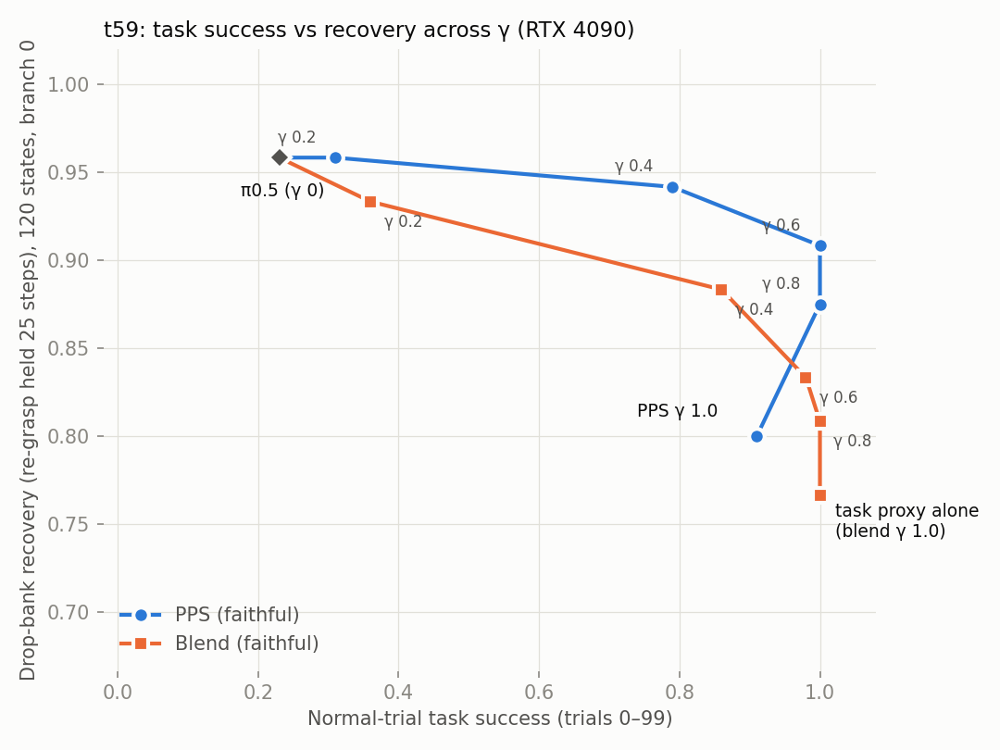
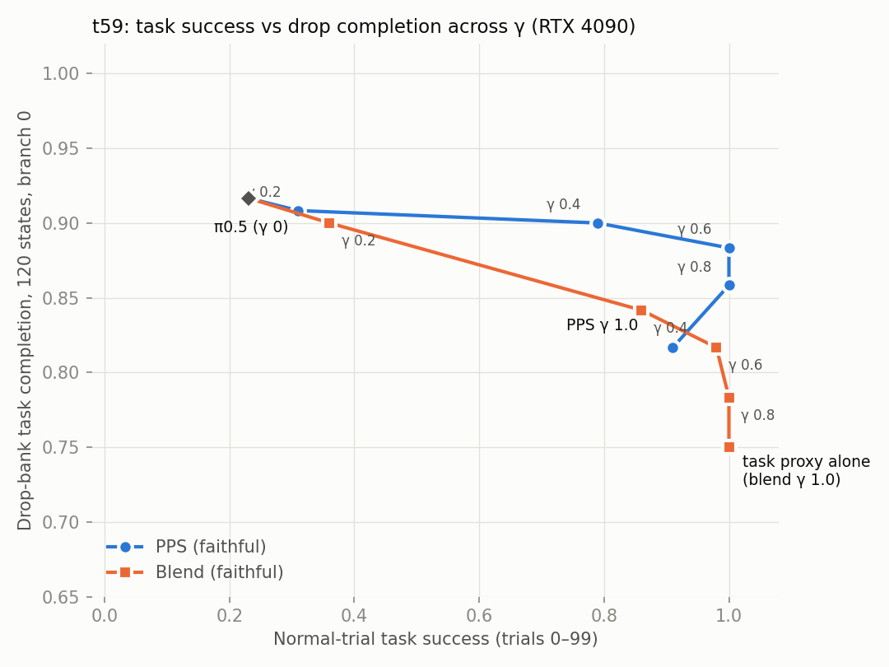

# t59: faithful PPS proxies vs π0.5, the task proxy alone and a plain blend

Final report, written 2026-11-11 about 1:50 pm New York time, replacing the 7:10 am interim. All rollouts and
training ran on the pod's RTX 4090. Times are New York time (UTC − 5). One training seed (s0) of each faithful
proxy. Protocol: [PROTOCOL.md](PROTOCOL.md) (written before any rollout). Full generated tables:
[TABLES.md](TABLES.md), machine-readable in [summary.json](summary.json).

## Run status

Checked at 1:41–1:46 pm (18:41–18:46 UTC).

- **Marker files** in `/workspace/runs/eval_t59_faithful`: `DONE` present (written 10:45 am). `CHECK_FAIL`,
  `COSINE_FAIL`, `TRAIN_FAIL` and `STOP` are absent. `logs/CHECK_FAIL_precision_assert_0511ET` is the
  5:11 am check failure. It was archived before the restart that passed at 5:17 am (see Checks).
- **Processes:** no `run_faithful.py` worker, `serve_faithful.py` server or `run_chain.sh` is alive. The GPU is idle
  (1 MiB used, 0% utilization, no compute processes).
- **Chain log** (`logs/chain.log`, the whole file, 23 lines, so the last 40 lines are all of it):

```
2026-11-11T06:26:02Z waiting for /workspace/runs/reference_t59_faithful_s0/final.pt
2026-11-11T08:15:24Z training task proxy
2026-11-11T08:51:19Z early: task training in steady state, GPU free 4140 MiB
2026-11-11T08:51:19Z early: not enough GPU memory for an early server, skipping
2026-11-11T10:08:33Z task proxy done
2026-11-11T10:08:33Z step 2 checks
2026-11-11T10:11:15Z CHECK FAILED
2026-11-11T10:12:33Z restart after fixing the precision assertion (pi0.5 itself sets 'high'); attempt-1 log kept as check_faithful_attempt1.log
2026-11-11T10:12:33Z waiting for /workspace/runs/reference_t59_faithful_s0/final.pt
2026-11-11T10:12:33Z task proxy done
2026-11-11T10:12:33Z step 2 checks
2026-11-11T10:17:27Z checks passed
2026-11-11T10:21:02Z servers up
{"trial": 0, "success_new": true, "success_old": true, "env_steps_new": 239, "env_steps_old": 239, "gpu_new": "NVIDIA GeForce RTX 4090", "gpu_old": "NVIDIA GeForce RTX 4090", "action_identical": true, "qpos_identical": true, "qvel_identical": true, "obj_identical": true, "identical": true}
{"trial": 10, "success_new": true, "success_old": true, "env_steps_new": 284, "env_steps_old": 284, "gpu_new": "NVIDIA GeForce RTX 4090", "gpu_old": "NVIDIA GeForce RTX 4090", "action_identical": true, "qpos_identical": true, "qvel_identical": true, "obj_identical": true, "identical": true}
{"trial": 57, "success_new": false, "success_old": false, "env_steps_new": 410, "env_steps_old": 410, "gpu_new": "NVIDIA GeForce RTX 4090", "gpu_old": "NVIDIA GeForce RTX 4090", "action_identical": true, "qpos_identical": true, "qvel_identical": true, "obj_identical": true, "identical": true}
{"trial": 133, "success_new": false, "success_old": false, "env_steps_new": 410, "env_steps_old": 410, "gpu_new": "NVIDIA GeForce RTX 4090", "gpu_old": "NVIDIA GeForce RTX 4090", "action_identical": true, "qpos_identical": true, "qvel_identical": true, "obj_identical": true, "identical": true}
REUSE_OK
2026-11-11T10:23:49Z workers up: 6
2026-11-11T10:29:51Z cosine check (ref vs base, real dims, steered path, 20 trials): 0.9422
2026-11-11T10:35:57Z bank complete, MORE removed
2026-11-11T15:45:14Z workers finished
2026-11-11T15:45:50Z done
```

  The workers ran from 5:23 am to 10:45 am. The summary ran at 10:45 am and the chain wrote `DONE` at 10:45:50 am.
  Nothing has been committed since `edb87a0` (12:09 UTC = 7:09 am, the evaluation code).
- **Complete cells and trial counts.** Every cell is complete. In every cell the number of records equals the
  number of per-episode step logs, and no record has an error.

| Cell | Normal trials (paired) | Drop-bank branches | Harder starts |
| --- | --- | --- | --- |
| `base` (π0.5) | 200 (trials 0–199, reused from the Nov 11 4090 run after a bit-exact reproduction) | 240 (120 states × 2) | 50 |
| `pps_f_g04` | 200 | 240 | 50 |
| `task_f` | 200 | 240 | 50 |
| `pps_f_g02`, `pps_f_g06`, `pps_f_g08`, `pps_f_g10` | 100 each (trials 0–99) | 120 each (branch 0) | — |
| `blend_f_g02`, `blend_f_g04`, `blend_f_g06`, `blend_f_g08` | 100 each (trials 0–99) | 120 each (branch 0) | — |
| `pps_v3_g04`, `task_v3` | 2 each (reproduction check only; the Nov 11 v3 trials 0–199 are reused) | 240 each | — |

- **The 9 am cut was applied.** All eight sweep cells have exactly 100 paired normal trials (0–99) and one branch
  (b = 0) per drop-bank state. The sweep did not run at full size. Item-1 cells (`base`, `pps_f_g04`, `task_f`) and
  item-3 cells (`pps_v3_g04`, `task_v3`) kept their specified sizes. As the 5:55 am addendum to PROTOCOL.md
  records, no further cuts were made when the queue ran late.
- **Not run:** item 4 (faithful training seeds 1 and 2), skipped on your instruction. `videos/` holds 18
  example clips and is not part of the results copied to the repo.
- **Audit across all runs:** all 3,514 trial records in the cell folders were run on the RTX 4090. The server counted padding-dim velocities
  against π0.5 on 68,121 calls in 2,740 episodes and found 0 violations.

## Main result

**Over the middle of the γ range (0.4–0.8), the PPS line sits above the blend line on the drop bank, by about 5–10
points of recovery at the same normal-trial success. At the two ends it does not: at γ 0.2 the two lines are
indistinguishable, and PPS γ 1.0 falls below the blend line.** The comparisons below use the trade-off plot's
trials: 100 normal trials and 120 drop branches per point.

- **At 100% normal success.** Both PPS γ 0.6 and blend γ 0.8 succeed on 100/100 normal trials. Blend γ 0.8 is the
  best blend point at 100%. PPS γ 0.6 recovered on 109/120 drop branches and blend γ 0.8 on 97/120, a gap of
  **+10.0 points (paired cluster-bootstrap 95% CI +5.0 to +15.8)**. They differ on 12 branches, and PPS is the one
  that recovered on all 12 (McNemar p = 0.0005). PPS γ 0.8 vs blend γ 0.8 is +6.7 [+2.5, +11.7], 8 vs 0 discordant.
  Task completion after the drop gives the same gaps: +10.0 and +7.5.
- **In the middle.** PPS γ 0.4 reaches 79/100 normal success. At that success its recovery is **+5.1 points above
  the blend line [+0.5, +10.2]**, so the lower end is close to zero. Measured on completion instead, the gap is
  +5.0 [+1.6, +9.2].
- **At the ends.** At γ 0.2 the gap is +1.5 [−2.0, +5.2], so the lines can't be told apart. PPS γ 1.0 lies
  **below** the blend line, −6.2 [−12.5, −0.8] on recovery. It also loses normal success, 91/100 against
  100/100 at γ 0.6–0.8.
- **Do the intervals overlap?** The per-point Wilson 95% intervals overlap at every γ. For example, recovery is
  [84.3, 94.8] for PPS γ 0.6 and [72.9, 86.9] for blend γ 0.8. Only the paired intervals exclude zero: both
  controllers ran from the same 120 states with the same noise, and the pairing removes the between-state
  variance.

How far this goes:
- **The effective sample is about 40 states.** Of the branches that PPS recovered and the blend did not, all but
  one start from the 40 bank states taken from π0.5 trajectories (11 of 12 for PPS γ 0.6 vs blend γ 0.8). On the
  80 states taken from PPS γ 0.4 and task-alone trajectories, nearly every controller completes and recovers 98–100%.
- **The sweep is at the cut size:** 100 normal trials and 1 branch per state, half the item-1 size.
- **One training seed** of each faithful proxy. Seeds 1 and 2 were not trained.
- **The PPS-vs-blend statistics were chosen after the plot was seen.** These are the vertical gap and the
  matched-success pairs (`scripts/faithful/pps_vs_blend.py`). They are not in PROTOCOL.md §6, which specifies only
  each cell against π0.5 and the plot. They are not corrected for multiple comparisons (5 γ × 2 metrics).
- **The comparison is about the trade-off, not either axis alone.** On normal trials alone, the blend gets more
  success than PPS at γ 0.2 and 0.4 (36 vs 31, 86 vs 79 out of 100).

The other headline numbers, unchanged since the interim report:
- On normal trials the task proxy alone succeeds 200/200.
- On the harder starts PPS γ 0.4 beats both components: 44/50, against 29/50 for π0.5 and 14/50 for the task
  proxy alone.
- The faithful proxies lift PPS γ 0.4 on normal trials over v3 ours: 76.0% vs 62.5%, +13.5 [+6.0, +22.0].

## What was run

| Cell | Velocity on the 7 real action dims (the 25 padding dims always get π0.5's velocity) |
| --- | --- |
| `base` | π0.5 alone |
| `pps_f_gXX` | faithful PPS: v_base + γ (v_task − v_ref), γ = 0.2, 0.4, 0.6, 0.8, 1.0 |
| `blend_f_gXX` | (1 − γ) v_base + γ v_task, faithful task proxy, γ = 0.2, 0.4, 0.6, 0.8 |
| `task_f` | faithful task proxy alone (their `--only_steer`), which is also the blend at γ = 1 (bit identical, checked) |
| `pps_v3_g04`, `task_v3` | v3 ours (Nov 11 code, unchanged) PPS γ 0.4 and task proxy alone |

Tests (details in PROTOCOL.md §3):
- **Normal trials.** Paired starts: trial i uses init state i mod 50 and the same env and noise seeds for every
  controller.
- **Common drop bank.** 120 mid-carry snapshots. States 0–39 come from π0.5 trials, 40–79 from PPS γ 0.4 trials
  and 80–119 from task-alone trials. Each branch drops the bottle and the controller has to finish the task
  within the original budget. Recovery means re-grasping and holding the bottle off the table for 25 consecutive
  steps. It is reported separately from task completion.
- **Harder starts.** 50 starts with the bottle moved 7 cm in −y, 2.1–7.0 cm outside the demos' range.

Wilson 95% intervals throughout. Paired differences are in percentage points, with a cluster-bootstrap 95%
interval: 10,000 resamples, clustered by init state, start or bank state. McNemar p is exact. Sweep cells are
paired against π0.5 on the same subset, normal trials 0–99 and bank branch 0. On that subset π0.5 is 23/100 on
normal trials (28.5% on all 200), 110/120 on completion and 115/120 on recovery.

## Results for every cell

### Normal trials (paired starts)

| Controller | n | Success, Wilson 95% | π0.5 on the same trials | Δ vs π0.5 (pts), cluster bootstrap 95% | McNemar p (cell only / π0.5 only) |
| --- | --- | --- | --- | --- | --- |
| π0.5 | 200 | 57/200 = 28.5% [22.7, 35.1] | — | — | — |
| PPS γ 0.2 (faithful) | 100 | 31/100 = 31.0% [22.8, 40.6] | 23/100 (trials 0–99) | +8.0 [-3.0, +19.0] | 0.18 (18 / 10) |
| PPS γ 0.4 (faithful) | 200 | 152/200 = 76.0% [69.6, 81.4] | 57/200 | +47.5 [+34.5, +60.5] | 4e-21 (105 / 10) |
| PPS γ 0.6 (faithful) | 100 | 100/100 = 100.0% [96.3, 100.0] | 23/100 (trials 0–99) | +77.0 [+68.0, +86.0] | 1.3e-23 (77 / 0) |
| PPS γ 0.8 (faithful) | 100 | 100/100 = 100.0% [96.3, 100.0] | 23/100 (trials 0–99) | +77.0 [+67.0, +86.0] | 1.3e-23 (77 / 0) |
| PPS γ 1.0 (faithful) | 100 | 91/100 = 91.0% [83.8, 95.2] | 23/100 (trials 0–99) | +68.0 [+56.0, +79.0] | 1.1e-18 (70 / 2) |
| blend γ 0.2 (faithful) | 100 | 36/100 = 36.0% [27.3, 45.8] | 23/100 (trials 0–99) | +13.0 [+1.0, +25.0] | 0.047 (25 / 12) |
| blend γ 0.4 (faithful) | 100 | 86/100 = 86.0% [77.9, 91.5] | 23/100 (trials 0–99) | +63.0 [+50.0, +75.0] | 3.1e-17 (65 / 2) |
| blend γ 0.6 (faithful) | 100 | 98/100 = 98.0% [93.0, 99.4] | 23/100 (trials 0–99) | +75.0 [+64.0, +84.0] | 1e-21 (76 / 1) |
| blend γ 0.8 (faithful) | 100 | 100/100 = 100.0% [96.3, 100.0] | 23/100 (trials 0–99) | +77.0 [+68.0, +86.0] | 1.3e-23 (77 / 0) |
| task proxy alone (faithful) | 200 | 200/200 = 100.0% [98.1, 100.0] | 57/200 | +71.5 [+62.5, +80.0] | 1.8e-43 (143 / 0) |

### Drop bank: task completion

| Controller | n | Success, Wilson 95% | π0.5 on the same trials | Δ vs π0.5 (pts), cluster bootstrap 95% | McNemar p (cell only / π0.5 only) |
| --- | --- | --- | --- | --- | --- |
| π0.5 | 240 | 220/240 = 91.7% [87.5, 94.5] | — | — | — |
| PPS γ 0.2 (faithful) | 120 | 109/120 = 90.8% [84.3, 94.8] | 110/120 (branch 0) | -0.8 [-5.0, +3.3] | 1 (3 / 4) |
| PPS γ 0.4 (faithful) | 240 | 221/240 = 92.1% [88.0, 94.9] | 220/240 | +0.4 [-2.9, +3.8] | 1 (7 / 6) |
| PPS γ 0.6 (faithful) | 120 | 106/120 = 88.3% [81.4, 92.9] | 110/120 (branch 0) | -3.3 [-8.3, +0.8] | 0.29 (2 / 6) |
| PPS γ 0.8 (faithful) | 120 | 103/120 = 85.8% [78.5, 91.0] | 110/120 (branch 0) | -5.8 [-11.7, -0.8] | 0.065 (2 / 9) |
| PPS γ 1.0 (faithful) | 120 | 98/120 = 81.7% [73.8, 87.6] | 110/120 (branch 0) | -10.0 [-15.8, -4.2] | 0.0018 (1 / 13) |
| blend γ 0.2 (faithful) | 120 | 108/120 = 90.0% [83.3, 94.2] | 110/120 (branch 0) | -1.7 [-6.7, +2.5] | 0.73 (3 / 5) |
| blend γ 0.4 (faithful) | 120 | 101/120 = 84.2% [76.6, 89.6] | 110/120 (branch 0) | -7.5 [-13.3, -2.5] | 0.012 (1 / 10) |
| blend γ 0.6 (faithful) | 120 | 98/120 = 81.7% [73.8, 87.6] | 110/120 (branch 0) | -10.0 [-15.8, -4.2] | 0.0018 (1 / 13) |
| blend γ 0.8 (faithful) | 120 | 94/120 = 78.3% [70.1, 84.8] | 110/120 (branch 0) | -13.3 [-20.0, -7.5] | 0.00014 (1 / 17) |
| task proxy alone (faithful) | 240 | 181/240 = 75.4% [69.6, 80.4] | 220/240 | -16.2 [-23.3, -9.6] | 8.7e-10 (3 / 42) |
| PPS γ 0.4 (v3 ours) | 240 | 218/240 = 90.8% [86.5, 93.9] | 220/240 | -0.8 [-5.0, +3.3] | 0.81 (8 / 10) |
| task proxy alone (v3 ours) | 240 | 200/240 = 83.3% [78.1, 87.5] | 220/240 | -8.3 [-13.8, -3.3] | 8.8e-05 (3 / 23) |

### Drop bank: recovery (re-grasp held 25 steps)

| Controller | n | Success, Wilson 95% | π0.5 on the same trials | Δ vs π0.5 (pts), cluster bootstrap 95% | McNemar p (cell only / π0.5 only) |
| --- | --- | --- | --- | --- | --- |
| π0.5 | 240 | 230/240 = 95.8% [92.5, 97.7] | — | — | — |
| PPS γ 0.2 (faithful) | 120 | 115/120 = 95.8% [90.6, 98.2] | 115/120 (branch 0) | +0.0 [-5.0, +5.0] | 1 (4 / 4) |
| PPS γ 0.4 (faithful) | 240 | 228/240 = 95.0% [91.5, 97.1] | 230/240 | -0.8 [-5.4, +3.3] | 0.81 (8 / 10) |
| PPS γ 0.6 (faithful) | 120 | 109/120 = 90.8% [84.3, 94.8] | 115/120 (branch 0) | -5.0 [-10.8, +0.0] | 0.15 (3 / 9) |
| PPS γ 0.8 (faithful) | 120 | 105/120 = 87.5% [80.4, 92.3] | 115/120 (branch 0) | -8.3 [-14.2, -3.3] | 0.0063 (1 / 11) |
| PPS γ 1.0 (faithful) | 120 | 96/120 = 80.0% [72.0, 86.2] | 115/120 (branch 0) | -15.8 [-22.5, -9.2] | 2.1e-05 (1 / 20) |
| blend γ 0.2 (faithful) | 120 | 112/120 = 93.3% [87.4, 96.6] | 115/120 (branch 0) | -2.5 [-8.3, +2.5] | 0.55 (4 / 7) |
| blend γ 0.4 (faithful) | 120 | 106/120 = 88.3% [81.4, 92.9] | 115/120 (branch 0) | -7.5 [-13.3, -1.7] | 0.022 (2 / 11) |
| blend γ 0.6 (faithful) | 120 | 100/120 = 83.3% [75.7, 88.9] | 115/120 (branch 0) | -12.5 [-19.2, -6.7] | 0.00027 (1 / 16) |
| blend γ 0.8 (faithful) | 120 | 97/120 = 80.8% [72.9, 86.9] | 115/120 (branch 0) | -15.0 [-21.7, -8.3] | 4e-05 (1 / 19) |
| task proxy alone (faithful) | 240 | 184/240 = 76.7% [70.9, 81.6] | 230/240 | -19.2 [-26.2, -12.5] | 3.5e-13 (1 / 47) |
| PPS γ 0.4 (v3 ours) | 240 | 225/240 = 93.8% [89.9, 96.2] | 230/240 | -2.1 [-5.4, +0.8] | 0.27 (4 / 9) |
| task proxy alone (v3 ours) | 240 | 204/240 = 85.0% [79.9, 89.0] | 230/240 | -10.8 [-16.2, -5.8] | 2.6e-06 (3 / 29) |

### Harder starts (bottle 7 cm off the demo range)

| Controller | n | Success, Wilson 95% | π0.5 on the same trials | Δ vs π0.5 (pts), cluster bootstrap 95% | McNemar p (cell only / π0.5 only) |
| --- | --- | --- | --- | --- | --- |
| π0.5 | 50 | 29/50 = 58.0% [44.2, 70.6] | — | — | — |
| PPS γ 0.4 (faithful) | 50 | 44/50 = 88.0% [76.2, 94.4] | 29/50 | +30.0 [+16.0, +44.0] | 0.00073 (17 / 2) |
| task proxy alone (faithful) | 50 | 14/50 = 28.0% [17.5, 41.7] | 29/50 | -30.0 [-48.0, -10.0] | 0.0081 (7 / 22) |

## Drop bank by state source

Rates by state source (n = branches per source per controller):

| Controller | branches per source | π0.5-sourced: completion / recovery | PPS γ 0.4-sourced | task-alone-sourced |
| --- | --- | --- | --- | --- |
| π0.5 | 80 | 75% / 88% | 100% / 100% | 100% / 100% |
| PPS γ 0.2 (faithful) | 40 | 72% / 88% | 100% / 100% | 100% / 100% |
| PPS γ 0.4 (faithful) | 80 | 76% / 85% | 100% / 100% | 100% / 100% |
| PPS γ 0.6 (faithful) | 40 | 65% / 72% | 100% / 100% | 100% / 100% |
| PPS γ 0.8 (faithful) | 40 | 57% / 62% | 100% / 100% | 100% / 100% |
| PPS γ 1.0 (faithful) | 40 | 48% / 45% | 98% / 98% | 100% / 98% |
| blend γ 0.2 (faithful) | 40 | 70% / 80% | 100% / 100% | 100% / 100% |
| blend γ 0.4 (faithful) | 40 | 55% / 68% | 98% / 98% | 100% / 100% |
| blend γ 0.6 (faithful) | 40 | 45% / 50% | 100% / 100% | 100% / 100% |
| blend γ 0.8 (faithful) | 40 | 38% / 45% | 98% / 98% | 100% / 100% |
| task proxy alone (faithful) | 80 | 29% / 31% | 98% / 99% | 100% / 100% |
| PPS γ 0.4 (v3 ours) | 80 | 74% / 82% | 100% / 100% | 99% / 99% |
| task proxy alone (v3 ours) | 80 | 54% / 60% | 98% / 96% | 99% / 99% |

Each controller fails mainly on the π0.5-sourced states, 0–39. Under the same event rule, PPS γ 0.4 and the task
proxy alone reach the carry early and cleanly: median event step 75 and 68, 334 and 342 steps of budget left. π0.5
reaches it late, after struggling: median step 208, 200 steps left, and 6 of its 40 source trials failed.
So nearly all of the bank's power to separate controllers comes from those 40 states.

### Retained / lost / acquired, each controller vs π0.5

Each cell reads **retained / lost / acquired / neither (n)**:
- retained: both succeed
- lost: only π0.5 succeeds
- acquired: only the controller succeeds
- neither: both fail

Pairs are per (state, branch). Sweep cells are compared on branch 0; item-1 and v3 cells on both branches.

Task completion:

| Comparison (A vs B) | All states | π0.5-sourced (0–39) | PPS γ 0.4-sourced (40–79) | task-alone-sourced (80–119) |
| --- | --- | --- | --- | --- |
| PPS γ 0.2 (faithful) vs π0.5 | 106 / 4 / 3 / 7 (n 120) | 26 / 4 / 3 / 7 (n 40) | 40 / 0 / 0 / 0 (n 40) | 40 / 0 / 0 / 0 (n 40) |
| PPS γ 0.4 (faithful) vs π0.5 | 214 / 6 / 7 / 13 (n 240) | 54 / 6 / 7 / 13 (n 80) | 80 / 0 / 0 / 0 (n 80) | 80 / 0 / 0 / 0 (n 80) |
| PPS γ 0.6 (faithful) vs π0.5 | 104 / 6 / 2 / 8 (n 120) | 24 / 6 / 2 / 8 (n 40) | 40 / 0 / 0 / 0 (n 40) | 40 / 0 / 0 / 0 (n 40) |
| PPS γ 0.8 (faithful) vs π0.5 | 101 / 9 / 2 / 8 (n 120) | 21 / 9 / 2 / 8 (n 40) | 40 / 0 / 0 / 0 (n 40) | 40 / 0 / 0 / 0 (n 40) |
| PPS γ 1.0 (faithful) vs π0.5 | 97 / 13 / 1 / 9 (n 120) | 18 / 12 / 1 / 9 (n 40) | 39 / 1 / 0 / 0 (n 40) | 40 / 0 / 0 / 0 (n 40) |
| blend γ 0.2 (faithful) vs π0.5 | 105 / 5 / 3 / 7 (n 120) | 25 / 5 / 3 / 7 (n 40) | 40 / 0 / 0 / 0 (n 40) | 40 / 0 / 0 / 0 (n 40) |
| blend γ 0.4 (faithful) vs π0.5 | 100 / 10 / 1 / 9 (n 120) | 21 / 9 / 1 / 9 (n 40) | 39 / 1 / 0 / 0 (n 40) | 40 / 0 / 0 / 0 (n 40) |
| blend γ 0.6 (faithful) vs π0.5 | 97 / 13 / 1 / 9 (n 120) | 17 / 13 / 1 / 9 (n 40) | 40 / 0 / 0 / 0 (n 40) | 40 / 0 / 0 / 0 (n 40) |
| blend γ 0.8 (faithful) vs π0.5 | 93 / 17 / 1 / 9 (n 120) | 14 / 16 / 1 / 9 (n 40) | 39 / 1 / 0 / 0 (n 40) | 40 / 0 / 0 / 0 (n 40) |
| task proxy alone (faithful) vs π0.5 | 178 / 42 / 3 / 17 (n 240) | 20 / 40 / 3 / 17 (n 80) | 78 / 2 / 0 / 0 (n 80) | 80 / 0 / 0 / 0 (n 80) |
| PPS γ 0.4 (v3 ours) vs π0.5 | 210 / 10 / 8 / 12 (n 240) | 51 / 9 / 8 / 12 (n 80) | 80 / 0 / 0 / 0 (n 80) | 79 / 1 / 0 / 0 (n 80) |
| task proxy alone (v3 ours) vs π0.5 | 197 / 23 / 3 / 17 (n 240) | 40 / 20 / 3 / 17 (n 80) | 78 / 2 / 0 / 0 (n 80) | 79 / 1 / 0 / 0 (n 80) |

Recovery:

| Comparison (A vs B) | All states | π0.5-sourced (0–39) | PPS γ 0.4-sourced (40–79) | task-alone-sourced (80–119) |
| --- | --- | --- | --- | --- |
| PPS γ 0.2 (faithful) vs π0.5 | 111 / 4 / 4 / 1 (n 120) | 31 / 4 / 4 / 1 (n 40) | 40 / 0 / 0 / 0 (n 40) | 40 / 0 / 0 / 0 (n 40) |
| PPS γ 0.4 (faithful) vs π0.5 | 220 / 10 / 8 / 2 (n 240) | 60 / 10 / 8 / 2 (n 80) | 80 / 0 / 0 / 0 (n 80) | 80 / 0 / 0 / 0 (n 80) |
| PPS γ 0.6 (faithful) vs π0.5 | 106 / 9 / 3 / 2 (n 120) | 26 / 9 / 3 / 2 (n 40) | 40 / 0 / 0 / 0 (n 40) | 40 / 0 / 0 / 0 (n 40) |
| PPS γ 0.8 (faithful) vs π0.5 | 104 / 11 / 1 / 4 (n 120) | 24 / 11 / 1 / 4 (n 40) | 40 / 0 / 0 / 0 (n 40) | 40 / 0 / 0 / 0 (n 40) |
| PPS γ 1.0 (faithful) vs π0.5 | 95 / 20 / 1 / 4 (n 120) | 17 / 18 / 1 / 4 (n 40) | 39 / 1 / 0 / 0 (n 40) | 39 / 1 / 0 / 0 (n 40) |
| blend γ 0.2 (faithful) vs π0.5 | 108 / 7 / 4 / 1 (n 120) | 28 / 7 / 4 / 1 (n 40) | 40 / 0 / 0 / 0 (n 40) | 40 / 0 / 0 / 0 (n 40) |
| blend γ 0.4 (faithful) vs π0.5 | 104 / 11 / 2 / 3 (n 120) | 25 / 10 / 2 / 3 (n 40) | 39 / 1 / 0 / 0 (n 40) | 40 / 0 / 0 / 0 (n 40) |
| blend γ 0.6 (faithful) vs π0.5 | 99 / 16 / 1 / 4 (n 120) | 19 / 16 / 1 / 4 (n 40) | 40 / 0 / 0 / 0 (n 40) | 40 / 0 / 0 / 0 (n 40) |
| blend γ 0.8 (faithful) vs π0.5 | 96 / 19 / 1 / 4 (n 120) | 17 / 18 / 1 / 4 (n 40) | 39 / 1 / 0 / 0 (n 40) | 40 / 0 / 0 / 0 (n 40) |
| task proxy alone (faithful) vs π0.5 | 183 / 47 / 1 / 9 (n 240) | 24 / 46 / 1 / 9 (n 80) | 79 / 1 / 0 / 0 (n 80) | 80 / 0 / 0 / 0 (n 80) |
| PPS γ 0.4 (v3 ours) vs π0.5 | 221 / 9 / 4 / 6 (n 240) | 62 / 8 / 4 / 6 (n 80) | 80 / 0 / 0 / 0 (n 80) | 79 / 1 / 0 / 0 (n 80) |
| task proxy alone (v3 ours) vs π0.5 | 201 / 29 / 3 / 7 (n 240) | 45 / 25 / 3 / 7 (n 80) | 77 / 3 / 0 / 0 (n 80) | 79 / 1 / 0 / 0 (n 80) |

### Retained / lost / acquired, PPS vs the task proxy alone

Same layout. Here lost means only the task proxy alone succeeds, and acquired means only PPS succeeds. PPS γ 0.4
uses both branches; the other γ use branch 0.

Task completion:

| Comparison (A vs B) | All states | π0.5-sourced (0–39) | PPS γ 0.4-sourced (40–79) | task-alone-sourced (80–119) |
| --- | --- | --- | --- | --- |
| PPS γ 0.4 vs task alone (faithful), both branches | 180 / 1 / 41 / 18 (n 240) | 22 / 1 / 39 / 18 (n 80) | 78 / 0 / 2 / 0 (n 80) | 80 / 0 / 0 / 0 (n 80) |
| PPS γ 0.4 vs task alone (v3 ours), both branches | 198 / 2 / 20 / 20 (n 240) | 41 / 2 / 18 / 19 (n 80) | 78 / 0 / 2 / 0 (n 80) | 79 / 0 / 0 / 1 (n 80) |
| PPS γ 0.2 (faithful) vs task alone, branch 0 | 89 / 1 / 20 / 10 (n 120) | 10 / 1 / 19 / 10 (n 40) | 39 / 0 / 1 / 0 (n 40) | 40 / 0 / 0 / 0 (n 40) |
| PPS γ 0.4 (faithful) vs task alone, branch 0 | 89 / 1 / 19 / 11 (n 120) | 10 / 1 / 18 / 11 (n 40) | 39 / 0 / 1 / 0 (n 40) | 40 / 0 / 0 / 0 (n 40) |
| PPS γ 0.6 (faithful) vs task alone, branch 0 | 90 / 0 / 16 / 14 (n 120) | 11 / 0 / 15 / 14 (n 40) | 39 / 0 / 1 / 0 (n 40) | 40 / 0 / 0 / 0 (n 40) |
| PPS γ 0.8 (faithful) vs task alone, branch 0 | 90 / 0 / 13 / 17 (n 120) | 11 / 0 / 12 / 17 (n 40) | 39 / 0 / 1 / 0 (n 40) | 40 / 0 / 0 / 0 (n 40) |
| PPS γ 1.0 (faithful) vs task alone, branch 0 | 89 / 1 / 9 / 21 (n 120) | 10 / 1 / 9 / 20 (n 40) | 39 / 0 / 0 / 1 (n 40) | 40 / 0 / 0 / 0 (n 40) |

Recovery:

| Comparison (A vs B) | All states | π0.5-sourced (0–39) | PPS γ 0.4-sourced (40–79) | task-alone-sourced (80–119) |
| --- | --- | --- | --- | --- |
| PPS γ 0.4 vs task alone (faithful), both branches | 183 / 1 / 45 / 11 (n 240) | 24 / 1 / 44 / 11 (n 80) | 79 / 0 / 1 / 0 (n 80) | 80 / 0 / 0 / 0 (n 80) |
| PPS γ 0.4 vs task alone (v3 ours), both branches | 203 / 1 / 22 / 14 (n 240) | 47 / 1 / 19 / 13 (n 80) | 77 / 0 / 3 / 0 (n 80) | 79 / 0 / 0 / 1 (n 80) |
| PPS γ 0.2 (faithful) vs task alone, branch 0 | 91 / 1 / 24 / 4 (n 120) | 12 / 1 / 23 / 4 (n 40) | 39 / 0 / 1 / 0 (n 40) | 40 / 0 / 0 / 0 (n 40) |
| PPS γ 0.4 (faithful) vs task alone, branch 0 | 91 / 1 / 22 / 6 (n 120) | 12 / 1 / 21 / 6 (n 40) | 39 / 0 / 1 / 0 (n 40) | 40 / 0 / 0 / 0 (n 40) |
| PPS γ 0.6 (faithful) vs task alone, branch 0 | 92 / 0 / 17 / 11 (n 120) | 13 / 0 / 16 / 11 (n 40) | 39 / 0 / 1 / 0 (n 40) | 40 / 0 / 0 / 0 (n 40) |
| PPS γ 0.8 (faithful) vs task alone, branch 0 | 92 / 0 / 13 / 15 (n 120) | 13 / 0 / 12 / 15 (n 40) | 39 / 0 / 1 / 0 (n 40) | 40 / 0 / 0 / 0 (n 40) |
| PPS γ 1.0 (faithful) vs task alone, branch 0 | 89 / 3 / 7 / 21 (n 120) | 11 / 2 / 7 / 20 (n 40) | 39 / 0 / 0 / 1 (n 40) | 39 / 1 / 0 / 0 (n 40) |

Against the task proxy alone, PPS at every γ from 0.2 to 0.8 loses at most 1 branch and acquires 13–24. Nearly
all of the acquired branches are on π0.5-sourced states.

## Success vs recovery: PPS line vs blend line





Every point uses the same trials: normal trials 0–99 (n = 100) and bank branch 0 of the 120 states (n = 120).
Both lines start at π0.5 (γ 0). The PPS line ends at PPS γ 1.0. The blend line ends at the task proxy alone,
which is blend γ 1.0. That is why PPS γ 0.4 is at 79%, not the 76% of its 200 trials, and π0.5 is at 23%.

Points with Wilson 95% intervals:

| Point | γ | normal success (n 100) | drop recovery (n 120) | drop completion (n 120) |
| --- | --- | --- | --- | --- |
| π0.5 | 0 | 23/100 = 23.0% [15.8, 32.2] | 115/120 = 95.8% [90.6, 98.2] | 110/120 = 91.7% [85.3, 95.4] |
| PPS | 0.2 | 31/100 = 31.0% [22.8, 40.6] | 115/120 = 95.8% [90.6, 98.2] | 109/120 = 90.8% [84.3, 94.8] |
| PPS | 0.4 | 79/100 = 79.0% [70.0, 85.8] | 113/120 = 94.2% [88.4, 97.1] | 108/120 = 90.0% [83.3, 94.2] |
| PPS | 0.6 | 100/100 = 100.0% [96.3, 100.0] | 109/120 = 90.8% [84.3, 94.8] | 106/120 = 88.3% [81.4, 92.9] |
| PPS | 0.8 | 100/100 = 100.0% [96.3, 100.0] | 105/120 = 87.5% [80.4, 92.3] | 103/120 = 85.8% [78.5, 91.0] |
| PPS | 1.0 | 91/100 = 91.0% [83.8, 95.2] | 96/120 = 80.0% [72.0, 86.2] | 98/120 = 81.7% [73.8, 87.6] |
| blend | 0.2 | 36/100 = 36.0% [27.3, 45.8] | 112/120 = 93.3% [87.4, 96.6] | 108/120 = 90.0% [83.3, 94.2] |
| blend | 0.4 | 86/100 = 86.0% [77.9, 91.5] | 106/120 = 88.3% [81.4, 92.9] | 101/120 = 84.2% [76.6, 89.6] |
| blend | 0.6 | 98/100 = 98.0% [93.0, 99.4] | 100/120 = 83.3% [75.7, 88.9] | 98/120 = 81.7% [73.8, 87.6] |
| blend | 0.8 | 100/100 = 100.0% [96.3, 100.0] | 97/120 = 80.8% [72.9, 86.9] | 94/120 = 78.3% [70.1, 84.8] |
| task proxy alone | 1.0 | 100/100 = 100.0% [96.3, 100.0] | 92/120 = 76.7% [68.3, 83.3] | 90/120 = 75.0% [66.6, 81.9] |

**Vertical gap.** For each PPS point, the gap is its y minus the highest value the blend line reaches at the same
normal success. The blend line is drawn as straight segments in γ order. The 95% interval comes from a joint
bootstrap (10,000 resamples) that resamples normal-trial init states (50 clusters of 2 trials) and bank states
(120) independently, then recomputes every point and the blend line:

| PPS γ | normal success | recovery gap (pts), 95% | resamples with gap > 0 | completion gap (pts), 95% | resamples > 0 |
| --- | --- | --- | --- | --- | --- |
| 0.2 | 31/100 | +1.5 [-2.0, +5.2] | 76.1% | +0.2 [-3.6, +4.3] | 49.6% |
| 0.4 | 79/100 | +5.1 [+0.5, +10.2] | 98.3% | +5.0 [+1.6, +9.2] | 100.0% |
| 0.6 | 100/100 | +10.0 [+4.2, +15.8] | 100.0% | +10.0 [+4.2, +15.0] | 100.0% |
| 0.8 | 100/100 | +6.7 [+1.7, +11.7] | 99.6% | +7.5 [+2.5, +12.5] | 99.9% |
| 1.0 | 91/100 | -6.2 [-12.5, -0.8] | 0.9% | -1.5 [-5.4, +1.9] | 19.4% |

**Paired on the 120 bank branches.** These pairs are at matched or near-matched normal success:

| A | B | normal success A / B (n 100 each) | metric | A | B | Δ A − B (pts), cluster bootstrap 95% | McNemar p (A only / B only) |
| --- | --- | --- | --- | --- | --- | --- | --- |
| PPS γ 0.6 | blend γ 0.8 | 100 / 100 | recovery | 109/120 | 97/120 | +10.0 [+5.0, +15.8] | 0.00049 (12 / 0) |
| PPS γ 0.6 | blend γ 0.8 | 100 / 100 | completion | 106/120 | 94/120 | +10.0 [+5.0, +15.8] | 0.00049 (12 / 0) |
| PPS γ 0.8 | blend γ 0.8 | 100 / 100 | recovery | 105/120 | 97/120 | +6.7 [+2.5, +11.7] | 0.0078 (8 / 0) |
| PPS γ 0.8 | blend γ 0.8 | 100 / 100 | completion | 103/120 | 94/120 | +7.5 [+3.3, +12.5] | 0.0039 (9 / 0) |
| PPS γ 0.6 | task proxy alone | 100 / 100 | recovery | 109/120 | 92/120 | +14.2 [+8.3, +20.8] | 1.5e-05 (17 / 0) |
| PPS γ 0.6 | task proxy alone | 100 / 100 | completion | 106/120 | 90/120 | +13.3 [+7.5, +20.0] | 3.1e-05 (16 / 0) |
| PPS γ 0.8 | task proxy alone | 100 / 100 | recovery | 105/120 | 92/120 | +10.8 [+5.8, +16.7] | 0.00024 (13 / 0) |
| PPS γ 0.8 | task proxy alone | 100 / 100 | completion | 103/120 | 90/120 | +10.8 [+5.8, +16.7] | 0.00024 (13 / 0) |
| PPS γ 0.6 | blend γ 0.6 | 100 / 98 | recovery | 109/120 | 100/120 | +7.5 [+3.3, +12.5] | 0.0039 (9 / 0) |
| PPS γ 0.6 | blend γ 0.6 | 100 / 98 | completion | 106/120 | 98/120 | +6.7 [+2.5, +11.7] | 0.0078 (8 / 0) |
| PPS γ 0.4 | blend γ 0.4 | 79 / 86 | recovery | 113/120 | 106/120 | +5.8 [+0.8, +11.7] | 0.065 (9 / 2) |
| PPS γ 0.4 | blend γ 0.4 | 79 / 86 | completion | 108/120 | 101/120 | +5.8 [+2.5, +10.0] | 0.016 (7 / 0) |

The full PPS-vs-blend tables, including retained / lost / acquired by source for each pair above, are in
[pps_vs_blend.md](pps_vs_blend.md) and [pps_vs_blend.json](pps_vs_blend.json).

## Faithful vs v3 ours on every shared cell

The shared cells are PPS γ 0.4 and the task proxy alone, on normal trials (200) and the drop bank (240). v3 was
not run on the harder starts or in the sweep, so those have no v3 comparison. The v3 normal trials are the Nov 11
4090 trials. Trials 0 and 10 were rerun here for both v3 cells and reproduced bit for bit
(`checks/v3_repro.json`).

| Cell | Test (n) | Metric | faithful | v3 ours | Δ faithful − v3 (pts), cluster bootstrap 95% | McNemar p (faithful only / v3 only) |
| --- | --- | --- | --- | --- | --- | --- |
| PPS γ 0.4 | normal (200) | success | 152/200 = 76.0% | 125/200 = 62.5% | +13.5 [+6.0, +22.0] | 3.5e-06 (31 / 4) |
| task proxy alone | normal (200) | success | 200/200 = 100.0% | 197/200 = 98.5% | +1.5 [+0.0, +4.0] | 0.25 (3 / 0) |
| PPS γ 0.4 | drop (240) | completion | 221/240 = 92.1% | 218/240 = 90.8% | +1.2 [-1.7, +4.6] | 0.61 (9 / 6) |
| PPS γ 0.4 | drop (240) | recovery | 228/240 = 95.0% | 225/240 = 93.8% | +1.2 [-2.5, +5.4] | 0.63 (10 / 7) |
| task proxy alone | drop (240) | completion | 181/240 = 75.4% | 200/240 = 83.3% | -7.9 [-13.8, -2.5] | 0.00055 (5 / 24) |
| task proxy alone | drop (240) | recovery | 184/240 = 76.7% | 204/240 = 85.0% | -8.3 [-14.6, -2.9] | 0.00082 (7 / 27) |

- **Normal trials:** the faithful proxies make PPS γ 0.4 clearly better than v3's (+13.5 points).
- **Drop bank, PPS:** the faithful PPS ties v3.
- **Drop bank, task proxy alone:** the faithful task proxy is worse than v3's, by about 8 points on both
  completion and recovery.
- **PPS vs task alone:** the faithful pair shows the bigger gap: +18.3 points of recovery against +8.8 for v3.
- **Cosine of the reference vs π0.5 velocity:** 0.942 faithful against 0.955 for v3, on real dims along the
  steered path.

## Checks: all passed

| Check | Result |
| --- | --- |
| γ = 0 bit identical to π0.5 | yes, on 12 demo observations: stock openpi `Policy.infer` = server base = PPS hook at γ 0 = blend hook at γ 0 (7-dim actions), and the raw 32-dim sampler output is equal (`torch.equal`) |
| Padding dims identical on every call at every γ | yes, 0 violations in 3,000 Euler steps checked before the run (PPS and blend at γ 0–1 and the task proxy alone). During the run the server counted 68,121 calls in 2,740 episodes, also with 0 violations |
| Cosine, ref vs π0.5 velocity, real dims, steered path, 20 normal trials of PPS γ 0.4 | **0.942**, the mean over all 7,690 (call, Euler step) points; the mean of per-trial means is 0.962 and the lowest trial is 0.893. Gate 0.85, paper 0.946. By Euler step: 0.982, 0.978, 0.973, 0.966, 0.958, 0.950, 0.941, 0.929, 0.902, 0.843 (`checks/cosine_20trials.txt`) |
| Task-alone fast path = their `--only_steer` hook path | bit identical (7-dim actions) |
| Blend γ 1 = task alone | bit identical |
| π0.5 reproduces the Nov 11 4090 trials | bit for bit on trials 0, 10, 57 and 133 (actions, qpos, qvel, bottle pose, outcome), so the 200 Nov 11 π0.5 normal trials are reused |
| v3 ours reproduces Nov 11 | bit for bit on trials 0 and 10, for both PPS γ 0.4 and task alone |

The Step 2 check first stopped at 5:11 am, before checking anything. It stopped on my own wrong assertion that
π0.5 runs at float32 matmul precision "highest". Upstream openpi's `PI0Pytorch.__init__` sets "high" itself
(`pi0_pytorch.py:111`), so π0.5, v3 and their proxies all run at "high" (TF32). The assertion was fixed and the
rerun passed at 5:17 am. The first attempt's log is `logs/check_faithful_attempt1.log`. Full check output:
`checks/check_faithful.json`.

## Choices made without asking

Building the proxies:
1. **LIBERO sizes.** Their `ProxyPytorch.__init__` hardcodes `ACTION_DIM = 8` (DROID) for `action_in_proj`,
   `action_out_proj` and `state_proj`. These three layers were rebuilt after their `__init__` with LIBERO's sizes,
   read from the pi05_libero norm stats: 7 real action dims and 8 real state dims. They use the same default
   `nn.Linear` initialization.
2. **Config values.** `gemma_12m`, `facebook/dinov3-vits16-pretrain-lvd1689m` and float32 come from their released
   task config, `proxy_isaaclab_droid_*_pi05_jointpos`. No LIBERO config was released.
3. **Training budget.** The reference trains 20,000 steps at batch 8 and the task proxy 24,000 steps at batch 64,
   from the `metadata.pt` of their released pot and weight checkpoints. Their tea task proxy used 32,000 steps, and
   I did not follow it.
4. **Seeds.** torch seed 42 + seed index. Only s0 was trained.
5. **Faster but equivalent training code.**
   - The teacher's PaliGemma prefix is cached once per frame, and teacher calls are batched 4 training steps at a
     time.
   - The student runs the 392 image tokens once per observation instead of once per path point.
   - Both are checked against their uncached code before training (numbers under "could not be matched" below).
   - The first launch, at 1:14 am, was stopped by these checks. Their tolerances were tighter than the noise floor
     of their own code (one uncached forward pass at batch 4 against the same pass at batch 8).
   - I changed the pass rule to "within about 2× the measured noise floor" and relaunched at 1:23 am. The stopped
     run is kept as `reference_t59_faithful_s0_failedcheck1`.
6. **Data.** The proxies train on the same 50 t59 demos (5,571 frames) and the same normalized action targets as
   v3, real dims only. Frames are drawn uniformly without replacement per epoch.

Evaluating:
7. **Steering.** Only the 7 real dims are steered, at every Euler step (`steer_step` 0). Padding dims always keep
   π0.5's velocity.
8. **Precision.** Proxy calls run at matmul precision "high" (TF32, as their `__init__` sets) inside a
   save/restore context. π0.5 runs at "high" too, its own setting.
9. **Task alone skips π0.5.** The task-alone cell is served by a fast path that doesn't run π0.5. It is bit
   identical on the 7 real dims, and the padding dims never reach the robot.
10. **Their per-step proxy cost is kept.** I followed their eval in rerunning the proxy's full 403-token sequence at
    every Euler step. That cost about 0.64 server-s per PPS call, against 0.46 planned.
11. **The blend rule is ours.** (1 − γ) v_base + γ v_task on the real dims. Their code has no blend.
12. **Reused trials.** π0.5 normal trials 0–199 are reused from the Nov 11 4090 run after a 4-trial bit-exact
    reproduction. The v3 normal trials are reused after a 2-trial reproduction, which I added at 5:25 am; it is not
    in the protocol.
13. **Sweep size.** I cut the sweep to 100 normal trials and 1 branch, the spec's lever for the 9 am deadline. I
    made no further cuts when the measured cost showed the queue would miss 9 am. It finished at 10:45 am, earlier
    than the 5:55 am estimate of 12:30–1 pm.
14. **Drop bank sources.** States are split 40 / 40 / 40 by source, the first qualifying trials in order. The
    π0.5 states come from trials 0–143. PROTOCOL.md §3 says 0 … 139, an estimate written before the selection
    ran.
15. **Harder starts.** The shift is −7 cm in world y, away from the tray. All 50 starts passed the settle check.
16. **Recovery definition.** 25 consecutive steps with both fingers on the bottle, the gripper commanded closed
    and no bottle-table contact. The thresholds come from the Nov 10 pilot.
17. **Which cosine is reported.** The cosine check reports the mean over all points (0.942), not the mean of
    per-trial means (0.962). The paper's definition of its 0.946 is not known exactly.
18. **Same subset for every plot point.** The trade-off plot uses normal 0–99 and branch 0 for every point,
    including the item-1 cells.

Writing this report:
19. **New PPS-vs-blend analysis.** I wrote `scripts/faithful/pps_vs_blend.py` and chose its method after seeing
    the plot.
    - Statistics: the vertical gap to the blend line, the joint bootstrap, and the matched pairs (PPS γ 0.6 and 0.8
      vs blend γ 0.8 and vs the task proxy alone, PPS γ 0.6 vs blend γ 0.6, PPS γ 0.4 vs blend γ 0.4).
    - It reuses `summarize_faithful.py`'s loader, recovery rule, Wilson, McNemar and cluster bootstrap.
    - It also adds the sweep's retained / lost / acquired tables against the task proxy alone. The generated
      summary only had them for γ 0.4.
20. **Seeds 1 and 2 skipped**, on your instruction this afternoon.

## What in the official code could not be matched

- **DINOv3 weights.** Their encoder loads Meta's gated `dinov3_vits16.pth` through `torch.hub`, and that file is
  not available.
  - I converted timm's ungated mirror, `vit_small_patch16_dinov3.lvd1689m`, into Meta's layout and loaded it
    strictly into Meta's module.
  - Patch tokens match timm exactly (max abs diff 0.0, eval mode).
  - Keys absent from timm and filled in: the qkv bias masks, `mask_token` and `rope_embed.periods`
    (`/workspace/checkpoints/dinov3_meta/convert_check.json`).
- **Their `openpi` fork vs upstream openpi.** Their package clashes with upstream openpi (215abfb), which runs
  π0.5 here and must not change.
  - Their four proxy modules run from their own source files under private module names.
  - 3 import lines in `proxy_pytorch.py` are redirected. Everything else is byte for byte, and the file hashes are
    logged in every training config.
  - Their `eval_steering.py` steering code and `PI0Pytorch.forward_for_distill` are copied into
    `faithful_steer.py` and `distill_faithful.py` rather than imported.
- **The `ACTION_DIM = 8` hardcode** cannot be used for LIBERO. The rebuilt layers are item 1 above.
- **Teacher cache and student restructuring** are equivalent but not bit identical to their code:
  - Cached teacher vs their uncached `forward_for_distill`, real-dim v_base: rel. L2 0.0245, against a noise
    floor of 0.0178. Final real-dim actions: 0.0039 against 0.0037.
  - Student: the loss matches to 7e-7 rel. L2. Gradients: rel. L2 0.0011 against a noise floor of 0.0007, and the
    lowest per-parameter cosine is 0.9993 against 0.9994 (`reference_t59_faithful_s0/checks.json`).
- **Their `torch.compile` of `sample_actions`** is disabled. That method is never called here.
- **Their training recipe is for IsaacLab DROID tasks.** Batch size, step counts, schedule and optimizer are
  transferred unchanged, but none of them was tuned for LIBERO by the authors.

## Run log (all on the RTX 4090)

| Run | Time | Notes |
| --- | --- | --- |
| Faithful reference s0, first launch | stopped 1:14 am | stopped by its own pre-training equivalence checks (choice 5); kept as `reference_t59_faithful_s0_failedcheck1` |
| Faithful reference s0 | 1:23–3:15 am | 20,000 steps, batch 8, 111.8 min; final probe cos(student, teacher velocity) 0.990, MSE 0.019 |
| Faithful task s0 | 3:16–5:08 am | 24,000 steps, batch 64, from the reference; 112.0 min; probe flow MSE 0.288 → 0.0052 |
| Step 2 checks | 5:08–5:17 am | first attempt stopped at 5:11 (wrong assertion), rerun passed 5:17 |
| Eval, 2 servers × 3 workers | 5:21 am – 10:45 am | item 1 done 7:05 am; sweep (item 2, cut) and v3 drop bank (item 3) done 10:45 am |
| Summary | 10:45 am | `DONE` |
| PPS-vs-blend analysis and this report | 1:45 pm | `scripts/faithful/pps_vs_blend.py` (CPU, 18 s) |
| Item 4, faithful seeds 1 and 2 | not run | skipped |

## Files

Copied to the repo (`results/eval_t59_faithful/`):
- this report
- [PROTOCOL.md](PROTOCOL.md) and [TABLES.md](TABLES.md)
- [summary.json](summary.json)
- [pps_vs_blend.md](pps_vs_blend.md) and [pps_vs_blend.json](pps_vs_blend.json)
- `tradeoff.png` and `tradeoff_drop_success.png`
- `checks/check_faithful.json` and `checks/cosine_20trials.txt`

On the pod only: per-episode npz step logs, jsonl records, logs, bank snapshots, videos and checkpoints, under
`/workspace/runs/eval_t59_faithful` and `/workspace/runs/{reference,task}_t59_faithful_s0`.
